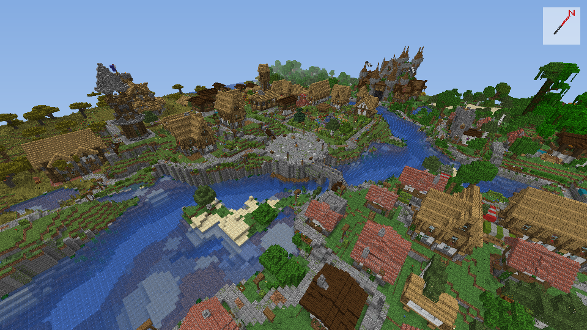
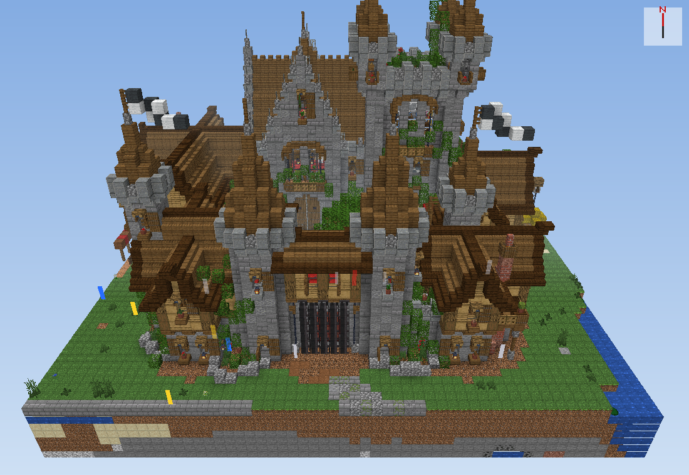
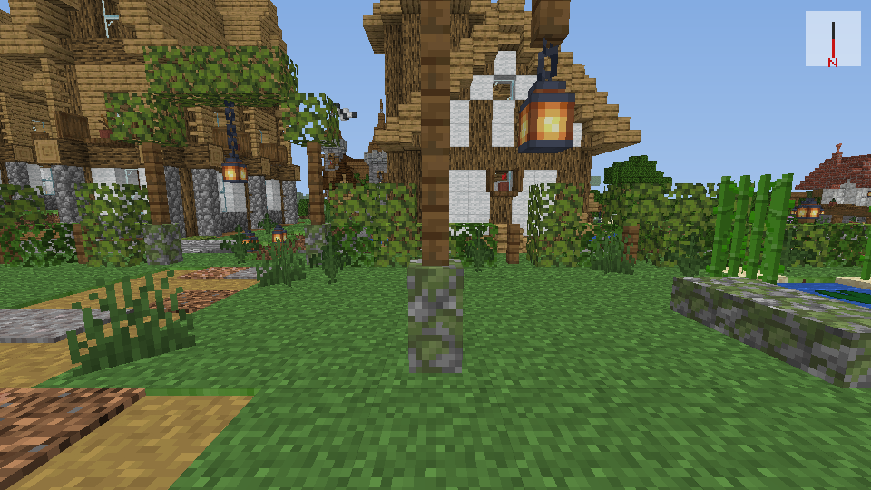
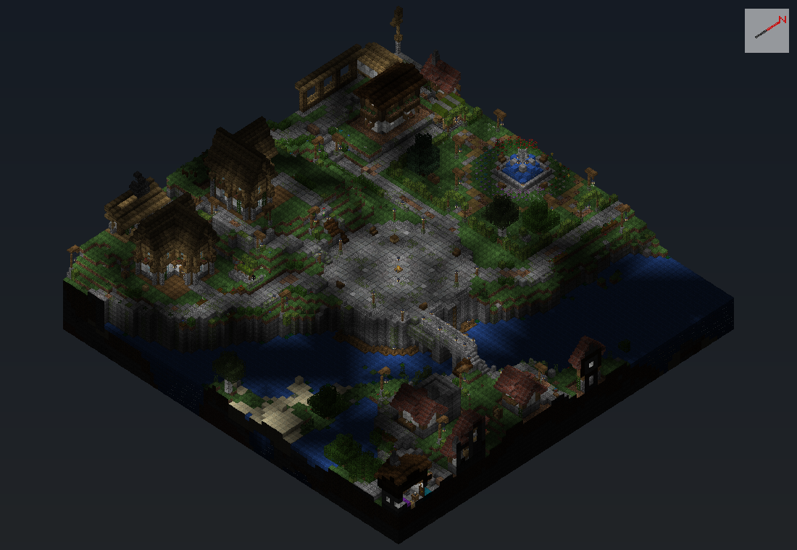
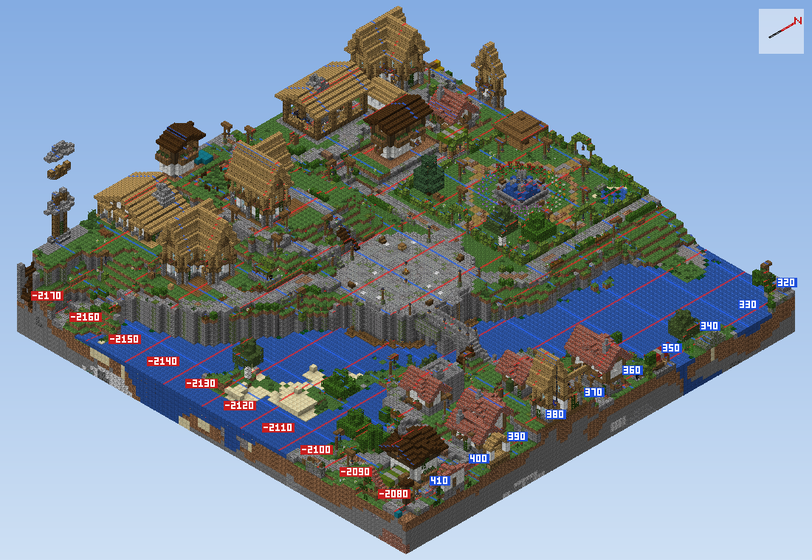
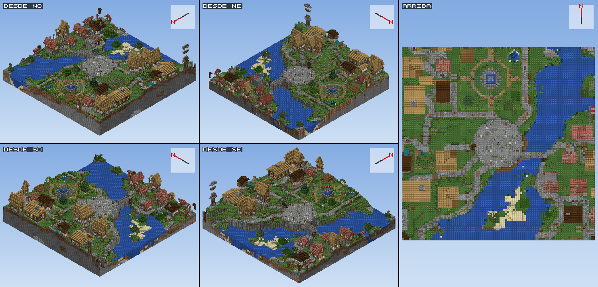

# Ojo del mundo

[](https://github.com/Dsergio909/ojo-del-mundo/actions/workflows/pruebas.yml)


**See a Minecraft Java world in 3D straight from its save files, without opening the game, and let an AI look at it too.**
Ojo del mundo (Spanish for "eye of the world") reads the world's `.mca` files and draws every block with its real shape and texture. Its MCP server lets Claude, or any MCP client, open your world, look at it from any angle, count blocks and read signs, so it can help you build without asking you for screenshots.

*En español más abajo: [ir a la versión en español](#en-español).*



## What it does

- **3D views of up to 128 blocks** from any angle: top-down, drone-like perspective, or from a player's eyes.
- **Real shapes and textures:** slabs, stairs, fences, chests, beds, banners with their patterns, paintings and item frames, plus modded blocks (it reads their `.jar`).
- **The game's light:** day, night, interiors and caves; torches and lanterns glow warm, water is transparent.
- **Mobs and villagers** as boxes of their real size, and a coordinate grid on the ground.
- **Count blocks** in an area, measure distances, and read signs and books.
- **Read-only and offline:** it never changes your world and never uploads anything.

| | |
|---|---|
|  |  |
| Drone-like perspective | From a player's eyes |
|  |  |
| At night, lit by torches and lanterns | Coordinate grid: red = x, blue = z |

## Quick start (3 steps)

1. **Have Python 3.10+ and Minecraft Java 1.18 or newer** installed. Textures come from your own copy of the game, so open your version once from the launcher.
2. **Install:**
   ```bash
   pip install git+https://github.com/Dsergio909/ojo-del-mundo
   ```
3. **Draw your world:**
   ```bash
   ojo-view --world "PATH/TO/.minecraft/saves/MyWorld" --x 0 --z 0 --radius 48 --out view.png
   ```

Where your worlds are: Windows `%APPDATA%\.minecraft\saves`, macOS `~/Library/Application Support/minecraft/saves`, Linux `~/.minecraft/saves`.

More views:
```bash
ojo-view --world ... --x 100 --z -40 --projection perspective --yaw 135 --pitch 30   # like a drone photo
ojo-view --world ... --x 100 --z -40 --camera 100 70 -60 --yaw 0 --pitch 10          # from a player's eyes
ojo-view --world ... --x 0 --z 0 --night --mobs                                      # night light, mobs marked
ojo-view --world ... --x 0 --z 0 --around                                            # 4 corners + top in one image
ojo-view --world ... --dimension the_nether --x 0 --z 0                              # the Nether
```
`--yaw` is the same number the game shows with F3: 0 = south, 90 = west, 180 = north, -90 = east.

## Use it with Claude (MCP)

The MCP server gives the AI 14 tools. Add it once:

**Claude Code**
```bash
claude mcp add ojo-del-mundo -- uvx --from git+https://github.com/Dsergio909/ojo-del-mundo ojo-mcp --world "PATH/TO/saves/MyWorld"
```

**Claude Desktop** (or any MCP client): add this to its config file.
```json
{
  "mcpServers": {
    "ojo-del-mundo": {
      "command": "uvx",
      "args": ["--from", "git+https://github.com/Dsergio909/ojo-del-mundo", "ojo-mcp", "--world", "PATH/TO/saves/MyWorld"]
    }
  }
}
```
On **Windows**, write the path with forward slashes (`C:/Users/...`) or with double backslashes (`C:\\Users\\...`). To find the config file, open Claude Desktop and go to **Settings > Developer > Edit Config**.

No `uv`? After `pip install` you can use `"command": "ojo-mcp"` instead. The `--world` part is optional: the AI can open a world later with `open_world`.

Then just ask, for example: *"Show me my base at x 120, z -300 from the northeast"*, *"How many diamond blocks are in my vault?"* or *"What do the signs in my village say?"*

| Tool | What it does |
|---|---|
| `open_world` | Opens a world folder; reports its name, Minecraft version, spawn point and dimensions |
| `world_info` / `use_dimension` | What is open; switch to the Nether or the End |
| `view_3d` | 3D picture with real textures, any angle, orthographic or perspective, player's-eye camera, night, mobs |
| `view_around` | The same area from the 4 corners and from above, in one image |
| `four_views` | Plan, isometric, front and side in one small image, with a legend of block ids |
| `top_down_map` / `side_section` / `isometric` | Quick maps: from above, a vertical cut, a simple isometric view |
| `blocks` | The exact blocks around a point, layer by layer, as text |
| `count_blocks` | How many of each block in an area, its real size, and where a given block is |
| `measure` | Distance and direction between two points |
| `read_texts` | What signs and books say in an area |
| `entities` | Villagers, mobs, animals, paintings, item frames, armor stands and dropped items |


*What `view_around` returns: the same area from the 4 corners and from above.*

## Security and privacy

- **Read-only:** it never changes your world.
- **No network access:** `ojo-mcp` and `ojo-view` do not connect to the internet or to any server.
- **What it reads:** the world folder you give it, and your own game `.jar`.
- **What it writes:** only images and a texture index, in your user cache folder.
- **`open_world`:** through this tool the AI can open any world folder your user account can read.

## Versions and limits

- **Tested with Minecraft Java 1.21.1.** It reads worlds saved by **1.18 or newer** (the current chunk format). For textures it uses 1.21.1 if installed, otherwise the newest 1.18+ version your launcher has; set `OJO_JAR` to use a specific client `.jar` (for example from Prism, CurseForge or MultiMC). Versions other than 1.21.1 have not been tested yet: if something looks wrong, please [open an issue](https://github.com/Dsergio909/ojo-del-mundo/issues) with your version.
- **Not supported:** worlds from before 1.18 (open them once in 1.18+ to convert them) and Bedrock Edition.
- **How close to the game:** checked against 7 real screenshots (day, night, a crypt and a tavern): colours match 83 to 95 %, and night brightness matches the game. Shader fog, shadows and reflections are left out on purpose so you can see further.
- **Modded blocks:** set `OJO_MODS` to your `mods` folder to get their textures.
- **Tool answers are in Spanish for now.** AI clients read them without trouble and answer you in your language; English output is planned.
- The first run builds a texture index (a few seconds); it and the images are saved in your user cache folder, never next to the code.

## Troubleshooting

- **Blocks are drawn black and magenta:** the game `.jar` was not found. Open your version once from the launcher, or set `OJO_JAR` to a client `.jar`.
- **"No hay chunks generados":** that area was never generated. Check the coordinates with F3.
- **`ojo-mcp` not found:** Python's Scripts folder is not on your PATH. Use `python -m ojo` instead, also in the JSON: `"command": "python", "args": ["-m", "ojo", "--world", "PATH/TO/saves/MyWorld"]`.
- **Recent changes do not show:** the game is open. Save and quit to title, or wait for the autosave, to see them.

## Tests

`python pruebas/probar.py` builds a tiny world from scratch (a house, a torch and a pond), reads its blocks, draws it from 4 angles, checks that both MCP servers start, uses the general one end to end like an AI would, and checks which game `.jar` is picked. No Minecraft needed. GitHub runs it on Windows, macOS and Linux, with Python 3.10 and 3.12.

## Files

| File | What it is |
|---|---|
| `ojo/ojo_mcp.py` | The general MCP server (`ojo-mcp`): any world, any OS |
| `ojo/ver_mundo.py` | The command-line viewer (`ojo-view`) |
| `ojo/ojo_vista3d.py` | The 3D renderer, written with numpy: models, textures, light, water, mobs |
| `ojo/mapa_aldea.py` | NBT and `.mca` region reader, top-down map |
| `ojo/ojo_del_mundo.py` | Block and entity reading, plus the author's original MCP server for his modpack (Windows, RCON, in-game photos, village plans). Kept as is; most people want `ojo_mcp.py` |
| `ojo/ojo_accesos.py` | Finds traps: spots you can fall into and not climb out of |
| `pruebas/` | The test world and the automated tests |

**Author's modpack extras** (not used by `ojo-mcp` or `ojo-view`): `ojo/rcon.py`, `ojo/ojo_ventana.ps1`, `ojo/probar_ojo3d.py`, `ojo/ojo_entrenar.py`, `ojo/ojo_prompt.json`: server commands by RCON, in-game photos on Windows, and question tuning for a local AI (Ollama).

---

# En español

**Ve un mundo de Minecraft Java en 3D desde sus archivos, sin abrir el juego, y deja que una IA también lo vea.**
Lo hice para que Claude revisara el pueblo de mi modpack *La Niebla de Herobrine* sin pedirme capturas. Lee los archivos `.mca` del mundo y dibuja cada bloque con su forma y su textura reales.

**En 3 pasos:**
1. Ten Python 3.10 o más nuevo y Minecraft Java 1.18 o más nuevo (ábrelo una vez con el launcher: de ahí salen las texturas).
2. Instala: `pip install git+https://github.com/Dsergio909/ojo-del-mundo`
3. Dibuja tu mundo: `ojo-view --mundo "RUTA/.minecraft/saves/MiMundo" --x 0 --z 0 --radio 48 --salida vista.png` (también sirven los nombres en inglés).

**Con Claude:** `claude mcp add ojo-del-mundo -- uvx --from git+https://github.com/Dsergio909/ojo-del-mundo ojo-mcp --world "RUTA/saves/MiMundo"`. El servidor trae 14 herramientas: abrir el mundo, vistas 3D, contar bloques, medir, leer carteles y ver entidades. Todo es de solo lectura y nada sale de tu computador.

**Privacidad:** solo lectura, sin internet, y solo escribe en la carpeta de caché.

Si `ojo-mcp` no aparece, usa `python -m ojo`.

**Versiones:** probado con la 1.21.1; lee mundos guardados desde la 1.18. Para las texturas usa la 1.21.1 si la tienes y, si no, la versión más nueva desde la 1.18 que haya instalado el launcher (otra ruta: `OJO_JAR`; mods: `OJO_MODS`). No sirve con mundos de antes de la 1.18 ni con Bedrock.

**Qué tan real se ve:** lo calibré con 7 fotos reales del juego. Los colores se parecen entre un 83 y un 95 %, y de noche el brillo es igual. No copia la niebla ni las sombras de los shaders, a propósito, para ver más lejos.

**Pruebas:** `python pruebas/probar.py` arma un mundo pequeño desde cero y revisa la lectura, las vistas, que arranquen los dos servidores MCP, usa el general como lo haría una IA y revisa la elección del `.jar`. GitHub las corre en Windows, Mac y Linux.

## License / Licencia

MIT. Made by Sergio García ([@Dsergio909](https://github.com/Dsergio909)) with help from Claude.
Minecraft is a trademark of Mojang / Microsoft. This is an unofficial project, not affiliated with them. No Mojang files are included: textures and models are read from your own copy of the game.
