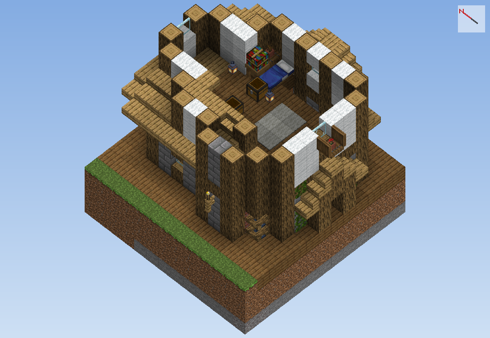
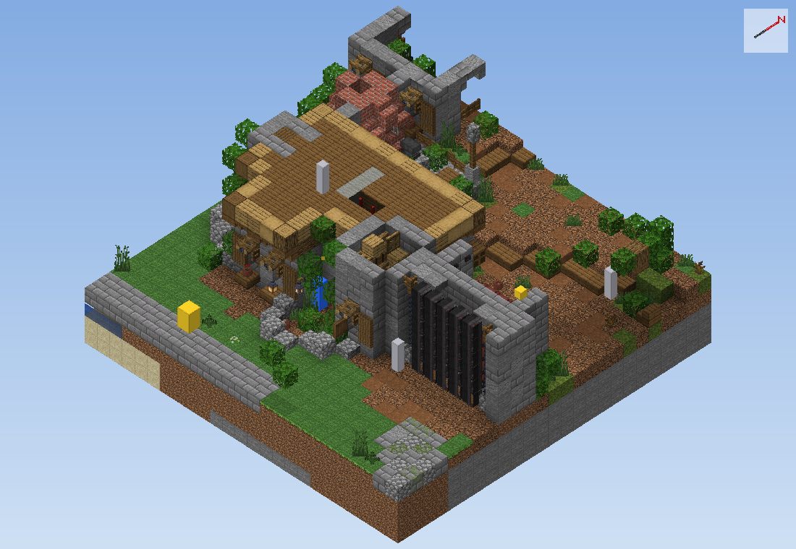
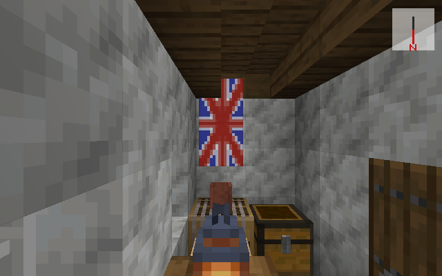
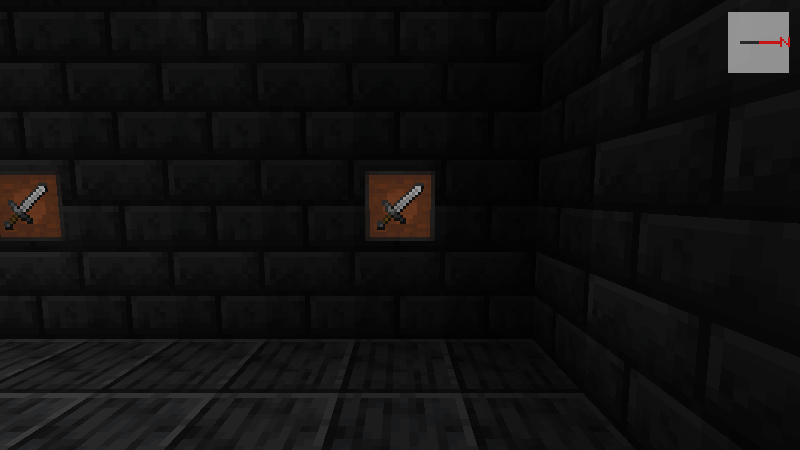

# Ojo del mundo 👁️

**Ve un mundo de Minecraft en 3D desde sus archivos, sin abrir el juego.**
Lo hice para que una IA (Claude) pudiera revisar el pueblo de mi modpack *La Niebla de Herobrine* sin pedirme capturas de pantalla: lee los archivos `.mca` del mundo y dibuja cada bloque con su forma y su textura reales.

*English below.*


## Qué hace

- **Vista 3D de hasta 128 bloques**, desde cualquier ángulo: desde arriba, en perspectiva como un dron, o desde los ojos de un jugador.
- **Formas reales**: losas, escaleras, cercas, cofres, camas, estandartes con su patrón, cuadros y marcos, y los bloques de los mods (lee sus `.jar`).
- **Luz del juego**: de día, de noche, dentro de las casas y en cuevas. Las antorchas y los faroles dan luz cálida, y el agua es transparente.
- **Mobs y aldeanos** en cajas de su tamaño real.
- **Cuadrícula de coordenadas** sobre el suelo, para contar y ubicar.
- **Contar bloques** de una zona, medir distancias y leer carteles y libros.
- **Comparar con una foto real** del juego, para saber cuánto se parece.
- **Servidor MCP** con 32 herramientas, para que Claude (u otra IA) vea y revise el mundo.

| | |
|---|---|
|  |  |
| Perspectiva tipo dron | Desde los ojos de un jugador |
|  |  |
| De noche, con la luz de antorchas y faroles | Cuadrícula: rojo = x, azul = z, cada 10 bloques |
|  |  |
| Interiores: camas, cofres y muebles | Mobs y aldeanos |
|  |  |
| Estandartes con su patrón | Cuadros y marcos |


*`--vuelta`: la misma zona desde las 4 esquinas y desde arriba, en una sola imagen.*

## Qué tan real se ve

Lo calibré con 7 fotos reales del juego (de día, de noche, en una cripta y dentro de una taberna). Los colores se parecen entre un 83 y un 95 %, y de noche el brillo es igual al del juego.
No copia la niebla, las sombras ni los reflejos de los shaders, y es a propósito: así se ve más lejos y se revisa mejor.

## Cómo se usa

Necesitas:
- Python 3.10 o más nuevo y `numpy` (`pip install numpy`).
- Minecraft Java **1.21.1** instalado. De su `.jar` salen las texturas y los modelos; este repositorio no trae ningún archivo de Mojang.

```bash
cd ojo
python ver_mundo.py --mundo "C:/Users/TU_USUARIO/AppData/Roaming/.minecraft/saves/MiMundo" --x 0 --z 0 --radio 48 --salida vista.png
```

Más ejemplos:

```bash
# perspectiva tipo dron, mirando al noreste
python ver_mundo.py --mundo ... --x 100 --z -40 --radio 64 --proyeccion perspectiva --giro 225 --inclinacion 35
# desde los ojos de un jugador parado en (100, 70, -60)
python ver_mundo.py --mundo ... --x 100 --z -40 --camara 100 71.6 -60 --giro 180 --inclinacion 10
# de noche, con los mobs y los muebles marcados
python ver_mundo.py --mundo ... --x 0 --z 0 --noche --seres --muebles
# la zona desde las 4 esquinas
python ver_mundo.py --mundo ... --x 0 --z 0 --vuelta
# el Nether
python ver_mundo.py --mundo ... --dimension the_nether --x 0 --z 0
```

- El giro es el mismo número que muestra el juego con F3: 0 = sur, 90 = oeste, 180 = norte, −90 = este.
- Si el juego está en otra carpeta: `OJO_JAR=ruta/al/1.21.1.jar`.
- Para ver los bloques de los mods con su textura: `OJO_MODS=ruta/a/la/carpeta/mods`.
- La primera vez tarda un poco más, porque arma un índice de las texturas (`ojo_vista3d_cache.pkl`). Ese archivo queda solo en tu PC.

### El servidor MCP (para Claude)

`ojo/ojo_del_mundo.py` es el servidor MCP completo que uso con Claude Code, tal cual. Está pensado para la carpeta de mi modpack:
- `servidor/` con su `server.properties`, para RCON y para saber qué mundo leer;
- `planos/` con el plano del pueblo, para las herramientas de casas.

Las vistas, contar bloques, mobs y textos funcionan con cualquier mundo. Algunas herramientas usan módulos de mi modpack que no vienen aquí (planos del pueblo, cliente de prueba para fotos), y esas avisan si les falta algo.

```json
{ "mcpServers": { "ojo-del-mundo": { "command": "python", "args": ["ruta/a/ojo/ojo_del_mundo.py"] } } }
```

Prueba rápida de todas las herramientas de imagen: `python ojo/probar_ojo3d.py`. Usa el mundo de pruebas de mi modpack: es el ejemplo de cómo lo pruebo.

## Archivos

| Archivo | Qué es |
|---|---|
| `ojo/ver_mundo.py` | Programa para ver cualquier mundo desde la terminal |
| `ojo/ojo_vista3d.py` | El dibujante 3D, hecho con numpy: modelos, texturas, luz, agua, mobs |
| `ojo/ojo_del_mundo.py` | Servidor MCP (32 herramientas) y lector de bloques y entidades de los `.mca` |
| `ojo/mapa_aldea.py` | Lector de NBT y de regiones `.mca`, y mapa 2D desde arriba |
| `ojo/ojo_accesos.py` | Busca encierros: sitios a los que uno cae y de los que no puede salir |
| `ojo/rcon.py` | Comandos al servidor por RCON (la clave se lee de tu `server.properties`) |
| `ojo/ojo_entrenar.py`, `ojo_prompt.json` | Entrenamiento de las preguntas para revisar fotos con una IA local (Ollama) |

---

# Eye of the world 👁️ (English)

**See a Minecraft world in 3D straight from its save files, without opening the game.**
I built it so an AI (Claude) could review the village of my modpack *La Niebla de Herobrine* without asking me for screenshots. It reads the world's `.mca` files and draws every block with its real shape and texture.

## Features
- **3D view of up to 128 blocks** from any angle: top-down, drone-like perspective, or player's eyes.
- **Real shapes**: slabs, stairs, fences, chests, beds, banners with their patterns, paintings, item frames and modded blocks (it reads their `.jar`).
- **Game lighting**: day, night, interiors and caves. Torches and lanterns give warm light, and the water is transparent.
- **Mobs and villagers** as boxes of their real size.
- **Coordinate grid** on the ground (red = x, blue = z, every 10 blocks).
- **Count blocks** in an area, measure distances, and read signs and books.
- **Compare against a real screenshot** to measure how close the render is. Calibrated with 7 real photos: 83–95 % colour match, and the same brightness as the game at night. Shader fog, shadows and reflections are left out on purpose, to see further.
- **MCP server** with 32 tools, so Claude (or another AI) can see and audit the world.

## Usage
Requires Python 3.10+, `numpy` and an installed copy of Minecraft Java **1.21.1**. Textures and models are read from your own game `.jar`; no Mojang files are included here.

```bash
cd ojo
python ver_mundo.py --mundo "path/to/.minecraft/saves/MyWorld" --x 0 --z 0 --radio 48 --salida view.png
```
(The option is `--radio`; `--giro` is the in-game yaw, `--inclinacion` the pitch, `--camara X Y Z` puts the camera at a point.)
- Other game folder: `OJO_JAR=path/to/1.21.1.jar`.
- Modded textures: `OJO_MODS=path/to/mods`.

`ojo/ojo_del_mundo.py` is the full MCP server I use with Claude Code, as is. It is built around my modpack's folder layout. The views, block counting, mobs and text work with any world; the village-plan tools need files that aren't included here, and they tell you when something is missing.

## Licencia / License
MIT. Hecho por Sergio García ([@Dsergio909](https://github.com/Dsergio909)) con ayuda de Claude.
Minecraft es una marca de Mojang / Microsoft. Este proyecto no es oficial y no tiene relación con ellos.
*Minecraft is a trademark of Mojang / Microsoft. This is an unofficial project, not affiliated with them.*
